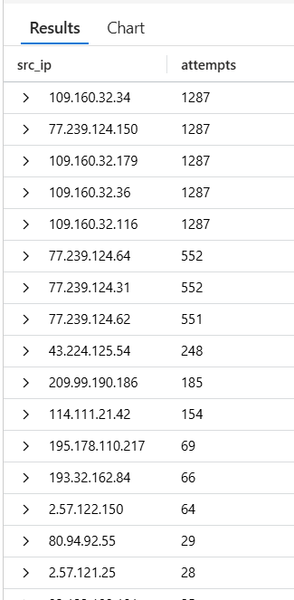
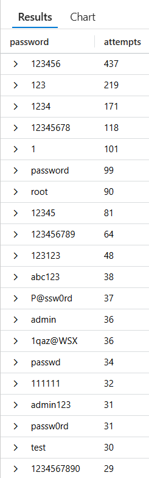
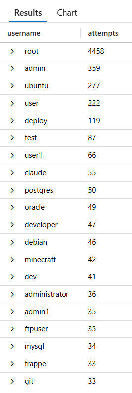
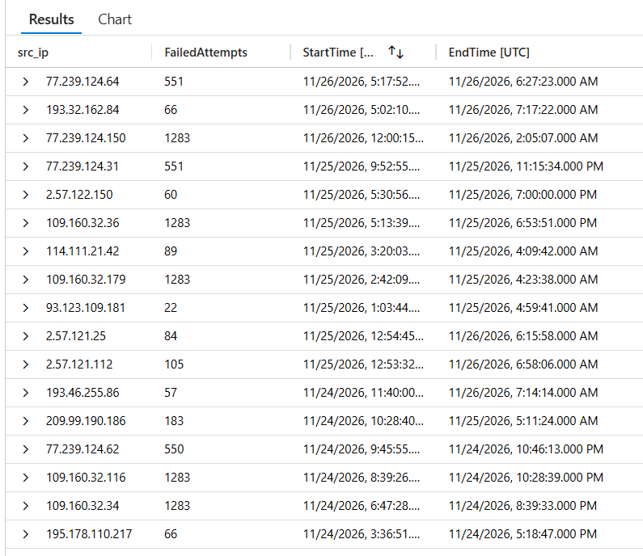
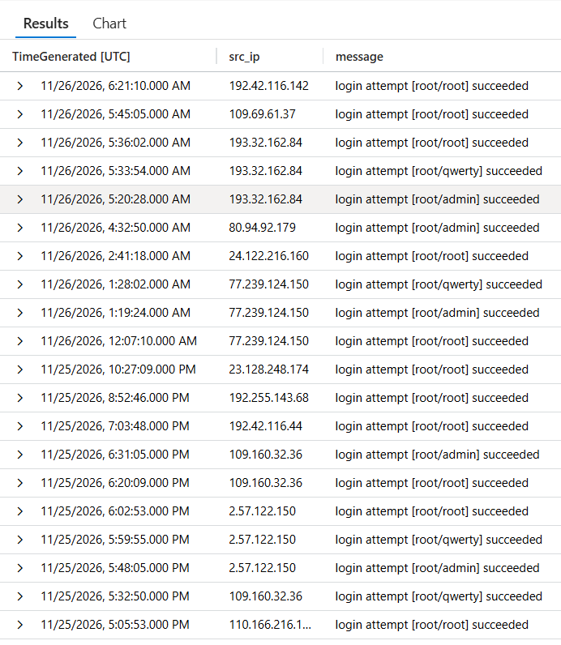
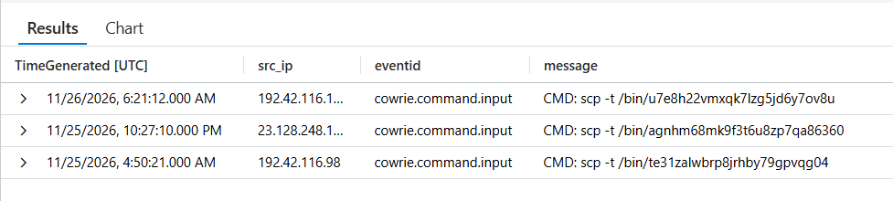
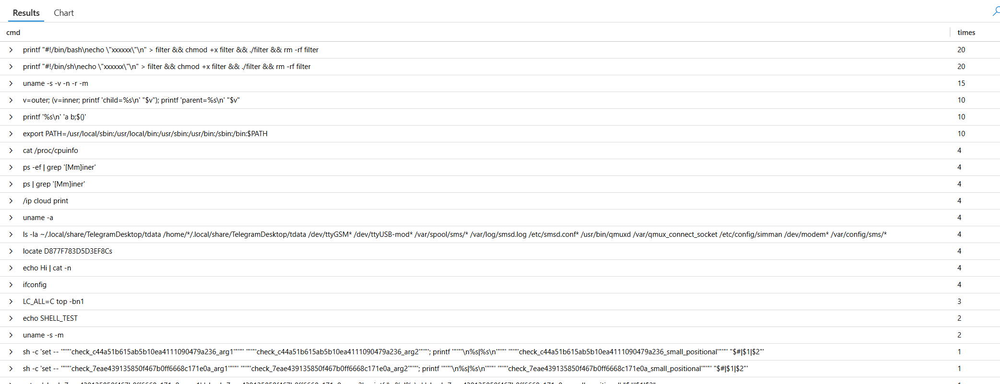
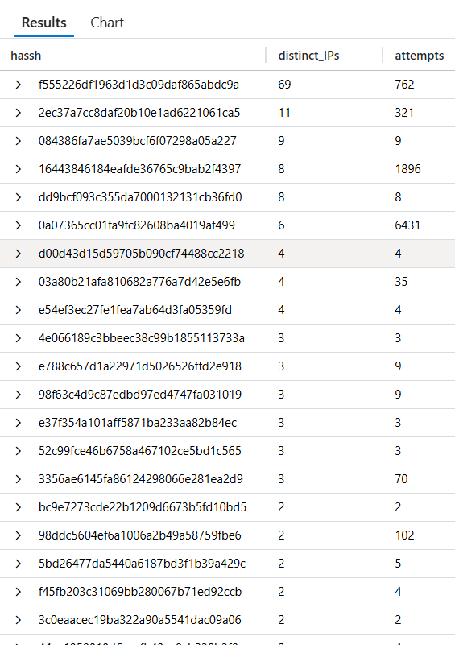

# Threat Analysis — Azure SSH Honeypot

Findings from live attacker traffic captured by the Cowrie honeypot and analysed in Microsoft Sentinel / Log Analytics (table `Cowrie_CL`). All queries used here are in [`kql/cowrie-hunting-queries.kql`](kql/cowrie-hunting-queries.kql).

Capture window: 24–26 Nov 2026 (approx. 4 days). Attacker source IPs are shown in full as published threat indicators; the admin IP and subscription identifiers are redacted.

---

## 1. Most active attackers, and a rotating botnet

**Question:** who is hitting the honeypot hardest?

```kql
Cowrie_CL
| where eventid == "cowrie.session.connect"
| summarize attempts = count() by src_ip
| sort by attempts desc
```



**Finding.** Five IPs landed on *exactly* 1287 attempts, spread across two different subnets (`109.160.32.0/24` and `77.239.124.0/24`), with a second tier clustered at ~552. The identical counts are a fingerprint: 1287 is almost certainly the size of the attacker's credential wordlist. Each IP runs the full list once, then the operator **rotates to a fresh IP in the block** and starts over. This is deliberate evasion — blocking one IP (`109.160.32.34`) simply hands off to the next (`109.160.32.36`). The same count appearing across *two* subnets indicates a single toolkit operated from multiple netblocks. The lead IP rates 100% malicious on AbuseIPDB (8,000+ reports).

---

## 2. Most-attempted passwords

**Question:** what passwords do the bots guess?

```kql
Cowrie_CL
| where eventid == "cowrie.login.failed"
| extend password = extract(@"/(.*)\] failed", 1, message)
| summarize attempts = count() by password
| sort by attempts desc
| take 20
```



**Finding.** The list is dominated by trivial passwords: `123456` (437), `123`, `1234`, and even a bare `1`. The "complex-looking" entries (`P@ssw0rd`, `1qaz@WSX`, `passw0rd`) are keyboard walks and breach-list staples, not real security. Every password here would fall instantly to an automated bot. This is the empirical case for key-only SSH and for never reusing a human-memorable password on anything internet-facing.

---

## 3. Most-targeted usernames

**Question:** what accounts are attackers hunting?

```kql
Cowrie_CL
| where eventid == "cowrie.login.failed"
| extend username = extract(@"\[([^/]+)/", 1, message)
| summarize attempts = count() by username
| sort by attempts desc
| take 20
```



**Finding.** `root` dominates at 4,458 attempts. Below it, the list reads like a census of what attackers expect to find: cloud defaults (`ubuntu`, `debian`), database accounts (`postgres`, `oracle`, `mysql`), deployment accounts (`deploy`, `dev`, `developer`, `git`), and application-specific users (`frappe` for ERPNext, `minecraft` for game servers). This is application-aware brute-force: tuned wordlists per popular software, not blind guessing.

---

## 4. Brute-force detection (Sentinel analytics rule)

**Question:** which IPs cross a brute-force threshold, and over what window?

```kql
Cowrie_CL
| where eventid == "cowrie.login.failed"
| summarize FailedAttempts = count(), StartTime = min(TimeGenerated), EndTime = max(TimeGenerated) by src_ip
| where FailedAttempts > 20
```



**Finding.** This query is the basis for a Microsoft Sentinel scheduled analytics rule (any IP with more than 20 failed logins per hour), mapped to **MITRE ATT&CK T1110 — Brute Force**, with the source IP mapped as an investigable entity. The rule runs hourly and has generated incidents autonomously from live attacks. The `StartTime`/`EndTime` columns show sustained campaigns, several running for hours.

---

## 5. Successful logins — decoy credentials used

**Question:** did anyone actually get in?

```kql
Cowrie_CL
| where eventid == "cowrie.login.success"
| where src_ip !in ("172.18.0.1", "127.0.0.1")
| project TimeGenerated, src_ip, message
| sort by TimeGenerated desc
```



**Finding.** Many attackers authenticated successfully using the honeypot's intentionally weak decoy credentials (`root/root`, `root/admin`, `root/qwerty`) from a wide spread of IPs. In a real environment each of these would be a confirmed breach. Mapped to **MITRE ATT&CK T1078 — Valid Accounts**. A separate high-severity Sentinel rule flags any success on the decoy. Self-generated test logins (localhost and the Docker gateway) are filtered out.

---

## 6. Malware delivery attempts

**Question:** did anyone try to drop a payload?

```kql
Cowrie_CL
| where eventid in ("cowrie.session.file_download", "cowrie.session.file_upload")
    or (eventid == "cowrie.command.input" and message has_any ("wget", "curl", "tftp", "scp", "ftpget"))
| project TimeGenerated, src_ip, eventid, message
| sort by TimeGenerated desc
```



**Finding.** Three `scp -t` upload attempts tried to push a binary into `/bin/` under a random filename, from IP ranges associated with Tor exit nodes (to be confirmed per-date via Tor Project ExoneraTor). None completed a transfer — no `file_upload` event followed, and the sessions closed within seconds. This is consistent with a known limit of medium-interaction honeypots: the emulated shell does not satisfy the attacker tooling, so payloads are not delivered. Mapped to **MITRE ATT&CK T1105 — Ingress Tool Transfer**.

---

## 7. Post-login behaviour and honeypot evasion

**Question:** what do attackers do once they are in?

```kql
Cowrie_CL
| where eventid == "cowrie.command.input"
| extend cmd = extract(@"CMD: (.*)", 1, message)
| summarize times = count() by cmd
| sort by times desc
| take 25
```



**Finding.** The command set reveals the automated playbook and multiple attacker objectives:

- **Honeypot / shell-fidelity detection** (most common): sessions write a tiny executable (`printf ... > filter && chmod +x filter && ./filter`) and run arithmetic, function, and subshell probes. These test whether the shell is real before delivering a payload. An emulated shell fails some, so sophisticated bots detect the honeypot and leave. This explains the low payload-capture rate and illustrates the medium- vs high-interaction trade-off.
- **System reconnaissance:** `uname -a`, `cat /proc/cpuinfo` — profiling CPU/RAM to decide whether the host is worth infecting.
- **Competitor eviction:** `ps -ef | grep '[Mm]iner'` — cryptominers checking for and killing rival miners already on the box.
- **Device targeting:** `/ip cloud print` (a MikroTik RouterOS command, testing for routers), and hunts for GSM modems and SMS spool paths (`/dev/ttyGSM*`, `/var/spool/sms/*`) for SMS-fraud, and Telegram session data (`~/.local/share/TelegramDesktop/tdata`) for account theft.

A single honeypot captured recon, cryptomining, router-compromise, SMS-fraud, and messenger-theft behaviours side by side.

---

## 8. Client fingerprints (hassh) — few tools, many IPs

**Question:** how many distinct tools are behind the swarm?

```kql
Cowrie_CL
| where eventid == "cowrie.client.kex"
| extend hassh = extract(@"fingerprint: (\w+)", 1, message)
| summarize distinct_IPs = dcount(src_ip), attempts = count() by hassh
| sort by distinct_IPs desc
```



**Finding.** A hassh is a hash of an SSH client's configuration, so it fingerprints the *tool* even when the IP changes. One hassh was shared by 69 distinct IPs, and another single fingerprint drove 6,431 attempts. Despite hundreds of attacking IPs, the traffic collapses into a small number of tools — hard evidence that this is a handful of automated toolkits and botnets, not many independent actors.

---

## Summary

Over roughly four days the honeypot recorded attacks from hundreds of unique IPs and surfaced:

- a rotating, multi-subnet brute-force campaign (fixed 1287-attempt wordlist per IP),
- trivial credentials dominating the attempts (`123456`, `root`),
- successful logins on decoy credentials (confirmed intrusions in a real setting),
- autonomous Sentinel detection of brute-force and decoy-login activity (MITRE T1110 / T1078 / T1105),
- multiple attacker objectives in one capture (mining, routers, SMS fraud, messenger theft),
- active honeypot-evasion probing, explaining the low payload-capture rate.

All detection logic is in [`kql/`](kql/cowrie-hunting-queries.kql); the architecture is in [`diagram.png`](diagram.png).