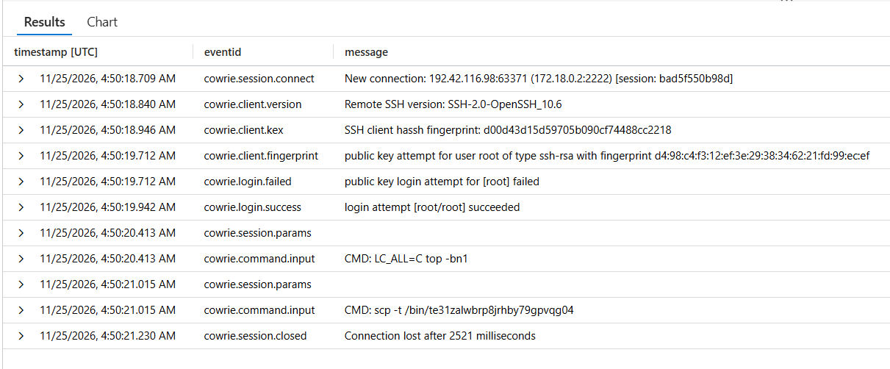

# Incident Investigation Report: Unauthorized SSH Access and Payload Staging

| Field | Value |
|---|---|
| Report ID | IR-2026-001 |
| Date of activity | 2026-11-25, 04:50 UTC |
| Analyst | Nick Koumaris |
| Source system | Azure SSH honeypot (Cowrie) into Microsoft Sentinel |
| Session ID | `bad5f550b98d` |
| Detection severity | Medium (brute-force rule) |
| Analyst-assessed impact | High (if this were a production host) |
| Classification | True Positive |
| Status | Resolved, contained by design (honeypot) |

---

## 1. Executive summary

On 2026-11-25 at 04:50 UTC, a source IP authenticated to the honeypot using a weak credential (`root/root`), ran a system-reconnaissance command, and attempted to upload a binary into `/bin/`, all within 2.5 seconds. The entire session was automated. The source IP is a confirmed Tor exit node, indicating the attacker anonymized their origin. The payload transfer did not complete, and the activity was fully contained by the honeypot's Docker isolation. On a real host this sequence would represent a confirmed root compromise and an attempted malware deployment.

---

## 2. Timeline (UTC, 2026-11-25)

| Time | Event | Detail |
|---|---|---|
| 04:50:18.709 | Connection | New connection from 192.42.116.98:63371 |
| 04:50:18.840 | Client version | SSH-2.0-OpenSSH_10.6 |
| 04:50:18.946 | Key exchange | hassh `d00d43d15d59705b090cf74488cc2218` |
| 04:50:19.712 | Public-key auth | Offered key for `root`, failed |
| 04:50:19.942 | Password auth | `root/root` succeeded (approx. 1.2s after connect) |
| 04:50:20.413 | Command | `LC_ALL=C top -bn1` (system/resource profiling) |
| 04:50:21.015 | Command | `scp -t /bin/te31zalwbrp8jrhby79gpvqg04` (upload attempt) |
| 04:50:21.230 | Disconnect | Session closed after 2,521 ms |

The sub-second spacing between steps and the 2.5-second total duration confirm a fully automated client, not a human operator. The client offered a public key before falling back to a password, which is the default OpenSSH method order and a cheap probe for hosts where the attacker has previously planted a key.

---

## 3. Indicators of Compromise (IoCs)

| Type | Value |
|---|---|
| Source IP | `192.42.116.98` (Tor exit node) |
| ASN / operator | AS215125, Church of Cyberology ("TOR Exit and More") |
| SSH client | SSH-2.0-OpenSSH_10.6 |
| hassh (client fingerprint) | `d00d43d15d59705b090cf74488cc2218` |
| Offered public key | `d4:98:c4:f3:12:ef:3e:29:38:34:62:21:fd:99:ec:ef` |
| Credential used | `root` / `root` |
| Attempted drop path | `/bin/te31zalwbrp8jrhby79gpvqg04` |

---

## 4. Enrichment

- **Tor exit node (confirmed).** `192.42.116.98` is listed on the Tor Project exit list (TorDNSEL) and on Spamhaus (SBL/XBL/PBL) and SpamCop blacklists. It belongs to AS215125 (Church of Cyberology, "TOR Exit and More"), whose `192.42.116.0/24` range is a dedicated block of Tor exit nodes.
- **Attribution caveat.** Geolocation sources disagree on the country (Netherlands, Iraq, Russia) because a Tor exit's location does not reflect the real attacker. The use of Tor is itself the finding: deliberate origin anonymization.
- **To confirm exit status on the exact date,** check the IP in the Tor Project ExoneraTor tool (`metrics.torproject.org/exonerator.html`) for 2026-11-25.

---

## 5. MITRE ATT&CK mapping

| Tactic | Technique | Evidence |
|---|---|---|
| Credential Access | T1110 Brute Force | Part of the broader brute-force campaign; weak credential guessed |
| Initial Access | T1078 Valid Accounts | Authenticated with `root/root` |
| Discovery | T1082 System Information Discovery | `top -bn1` resource profiling |
| Command and Control | T1105 Ingress Tool Transfer | `scp -t` attempt to upload a binary |

---

## 6. Analysis

The session follows a common commodity-botnet pattern. The client tried public-key authentication first (a quick probe), then fell back to a password and succeeded immediately on `root/root`. The first action after login was `top -bn1`, which profiles CPU and memory; bots use this to decide whether a host is worth infecting, typically for cryptomining or DDoS. The attacker then attempted `scp -t` to push a binary named with a random string into `/bin/`, a system path used to establish persistence.

No `cowrie.session.file_upload` event followed the `scp` command, and the session closed 215 ms later, so the transfer did not complete. This is consistent with the behaviour of a medium-interaction honeypot: the emulated shell does not satisfy the attacker's tooling, so the payload is not delivered.

The use of a Tor exit node shows the operator took steps to anonymize the source, which is common for staging infrastructure.

---

## 7. Severity and impact

On the honeypot, impact is **none**: the attacker interacted only with an emulated shell inside a Docker container with default-deny outbound networking, and never touched the host.

On a **production host**, the same sequence would be **High severity**: unauthorized root access achieved in seconds, followed by an attempt to plant an executable. The likely outcome would be enrollment into a botnet (mining or DDoS) and persistence in `/bin/`, with potential for lateral movement.

---

## 8. Verdict

**True Positive, malicious.** Confirmed unauthorized access via a guessed credential, system reconnaissance, and an attempted malware upload from an anonymized (Tor) source.

---

## 9. Recommendations

1. **Key-only SSH.** Disable password authentication (`PasswordAuthentication no`) and root login (`PermitRootLogin no`). (Already enforced on this lab's admin service on port 2222.)
2. **Rate limiting / lockout.** Deploy `fail2ban` or equivalent to throttle repeated failures.
3. **Restrict management access.** Limit the admin SSH port to known source IPs (as done here), rather than exposing it to the internet.
4. **Monitor for staging behaviour.** Alert on `scp`/`wget`/`curl` writing to system paths such as `/bin`, and on outbound connections to mining pools.
5. **File integrity monitoring** on `/bin` and other system directories.
6. **Consider Tor-aware policy** for management interfaces, weighing the trade-offs of blocking Tor exit ranges.

---

## 10. Appendix: detection and evidence

**Triggering analytics rule:** scheduled brute-force rule (more than 20 failed logins per IP per hour, MITRE T1110), source IP mapped as an IP entity. A second high-severity rule flags any successful login on the decoy (T1078).

**Sentinel incident:**



**Session retrieval query:**

```kql
Cowrie_CL
| where src_ip == "192.42.116.98"
| project timestamp, eventid, message
| sort by timestamp asc
```

**Sources:** Tor Project exit list (TorDNSEL), Spamhaus, and public IP-reputation services (nerd.liberouter.org, bigdatacloud.com, ipinfo.io) for the Tor/ASN enrichment.