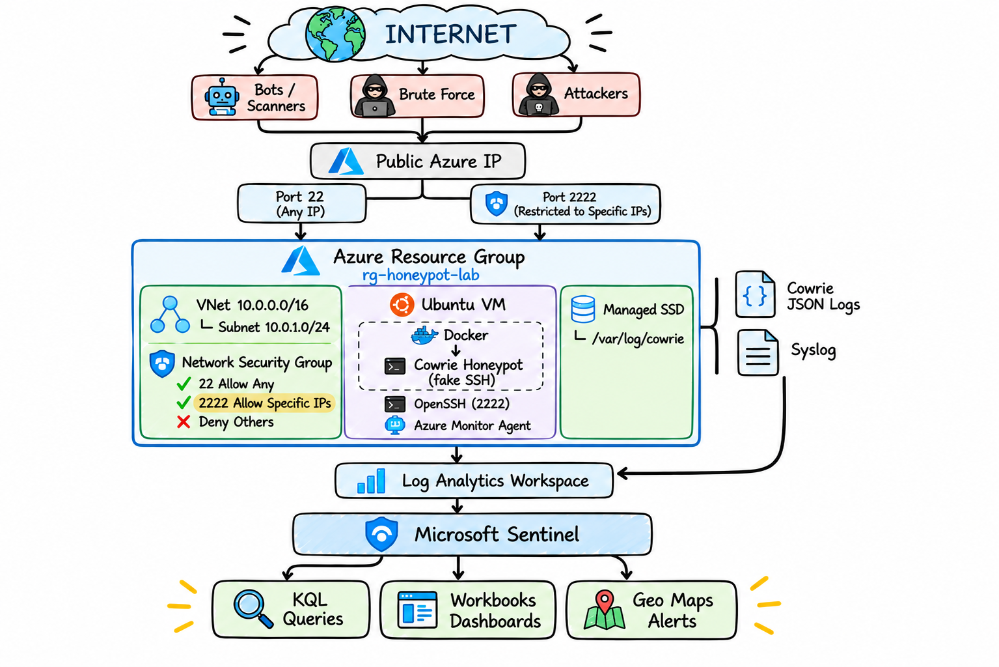

# Azure SSH Honeypot & Cloud SIEM Lab

A deliberately exposed SSH honeypot in **Microsoft Azure**, built with **Terraform**. Bots and attackers find the public IP, try to log in and run commands. **Cowrie** (in Docker) records everything inside a fake shell. Logs flow through the **Azure Monitor Agent** into **Log Analytics**, where **Microsoft Sentinel** is used for KQL threat hunting, detection rules and incidents.

One `terraform apply` builds the lab. One `terraform destroy` removes it.


---

## Progress

**Overall:** `▓▓▓▓░░░░░░░░░░░░░░░░` **25%** (30 of 122 tasks) · last updated 22 Nov 2026

| Phase | Milestone | Progress | Status |
|---|---|---|---|
| 0. Safety guardrails | M0 Account security & cost control | `▓▓▓▓▓▓▓▓▓▓` 100% | ✅ Done |
| 1. Infrastructure | M1 Azure networking | `▓▓▓▓▓▓▓▓▓▓` 100% | ✅ Done |
| | M2 Ubuntu VM deployment | `▓▓▓▓▓▓▓▓▓▓` 100% | ✅ Done |
| | M3 Linux & network administration | `▓▓▓▓▓▓▓░░░` 67% | 🟡 In progress |
| 2. Automation & honeypot | M4 Terraform | `▓▓▓░░░░░░░` 33% | 🟡 In progress |
| | M5 Docker fundamentals | `░░░░░░░░░░` 0% | ⬜ |
| | M6 Cowrie SSH honeypot | `░░░░░░░░░░` 0% | ⬜ |
| | M6.5 Decoy data (honeytokens) | `░░░░░░░░░░` 0% | ⬜ |
| 3. Monitoring & SIEM | M7 Azure Monitor & Log Analytics | `░░░░░░░░░░` 0% | ⬜ |
| | M8 KQL | `░░░░░░░░░░` 0% | ⬜ |
| | M9 Microsoft Sentinel | `░░░░░░░░░░` 0% | ⬜ |
| 4. SOC skills | M10 Threat detection & MITRE ATT&CK | `░░░░░░░░░░` 0% | ⬜ |
| | M11 SOC investigation report | `░░░░░░░░░░` 0% | ⬜ |
| 5. Portfolio | M12 Final documentation | `░░░░░░░░░░` 0% | ⬜ |

Full checklist: [`tasks.md`](tasks.md)

---

## Why I'm building it

A portfolio project for my move into cybersecurity (target role: **SOC Analyst**). It shows three skills that are hard to prove on a CV:

- **Cloud:** designing and running real infrastructure in Azure
- **Infrastructure as Code:** every resource defined and rebuilt from Terraform
- **Security operations:** real attack data in a SIEM, KQL hunting, detections and an incident report

---

## Architecture



---

## Security design ()

- **Identity:** MFA on the Azure account (also required by Azure for CLI and IaC tools); SSH keys only for admin access
- **Inbound:** port 22 open as bait; port 2222 limited to my current admin IP (see below)
- **Host firewall:** `ufw` default-deny inbound, only 2222 allowed (second layer behind the NSG)
- **Outbound:** default-deny NSG, so the VM can't be used to attack others (only Azure Monitor, Entra ID and HTTP/S for updates allowed)
- **Isolation:** Cowrie runs in Docker as non-root; attacker commands never touch the real system
- **Data:** no real secrets on the VM; decoy credentials are fake and traceable

### Admin access with a dynamic IP

Azure NSGs can't filter by country, only by IP ranges and service tags. My home connection has a dynamic IP, so:

- Port 2222 allows **only my current public IP as a `/32`**, held in the Terraform variable `admin_source_ips`
- If my IP changes, I update the rule (portal, Azure CLI or `terraform apply`). It takes under a minute, and I can never be locked out, because the Azure portal doesn't depend on my IP
- **Key-only SSH** on port 2222: `PasswordAuthentication no`, `PermitRootLogin no`
- Optional second layer on the VM: `fail2ban`

```bash
# From my own computer (not Cloud Shell, which would return Azure's IP)
az network nsg rule update -g rg-honeypot-lab --nsg-name nsg-honeypot \
  -n Allow-Admin-SSH-2222 --source-address-prefixes "$(curl -s ifconfig.me)/32"
```

### Keeping my IP out of the repo

My home IP is personal data and the only address allowed to reach real SSH, so it's never committed:

- The real value lives in `terraform.tfvars`, which is in `.gitignore`
- The repo has `terraform.tfvars.example` with a documentation placeholder (`203.0.113.10/32`)
- Home IPs are blurred in screenshots

---

## Cost

| | |
|---|---|
| Region | East US |
| VM size | `Standard_B2ats_v2` for the run (B1s/B2s were blocked on the new subscription) |
| Temporary build VM | `Standard_D2als_v6` (~$0.08/h, stopped when not in use) while the Basv2 vCPU quota request (0 → 4) is pending |
| Infrastructure | **~$12.25/month** (24/7) |
| Planned run | 1 month of data collection, then `terraform destroy` |
| Expected total | **~$12–22** |
| Guardrails | Monthly budget with 50/80/100% and forecast alerts |

Details: [`docs/01-cost-estimate.md`](docs/01-cost-estimate.md)

---

## Tech stack

Microsoft Azure · Terraform (azurerm) · Ubuntu 24.04 · Docker · Cowrie · Azure Monitor Agent · Data Collection Rules · Log Analytics · Microsoft Sentinel · KQL · Azure CLI

## Documentation

- [`project_description.md`](project_description.md): full design
- [`tasks.md`](tasks.md): learning roadmap
- [`docs/00-account-setup.md`](docs/00-account-setup.md): Milestone 0 notes
- [`docs/01-cost-estimate.md`](docs/01-cost-estimate.md): cost estimate
- [`docs/02-networking.md`](docs/02-networking.md): Milestones 1–2, network, NSG rules, VM and firewall tests

## Repository safety

No secrets, keys, personal IP addresses, `.tfvars` or Terraform state are committed (`.gitignore` covers `*.tfvars`, `*.tfstate*` and `.terraform/`). The honeypot only observes; it never attacks back.
